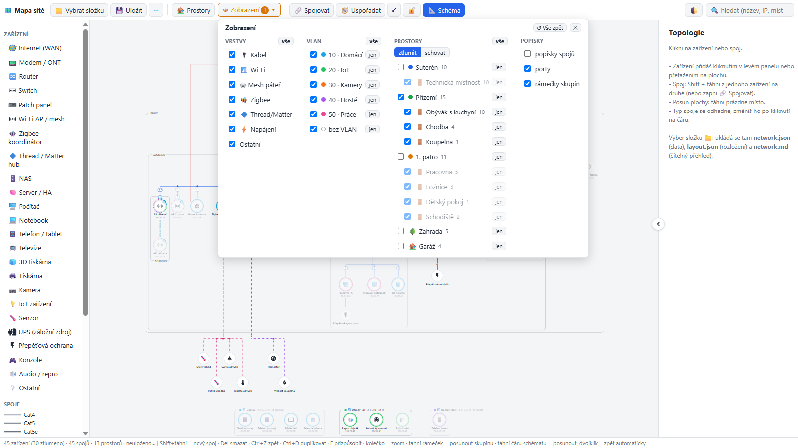

# Home Network Map · Mapa domácí sítě

[English](#english) · [Česky](#česky)


---

## English

A single-file editor for documenting a home network: `mapa.html` (vanilla JS + SVG, no dependencies, no build step).
It draws the network as a **topology**: a tree from the internet down to every device, with group frames around each router, switch, and AP subtree.

> The user interface is in **English** and **Czech** (chosen by your browser language, switch in the header).

### Features
- **Devices and links:** routers, switches, patch panels, Wi-Fi APs and mesh, NAS, servers, cameras, IoT, Zigbee/Thread, UPS and surge protectors. Links include cable categories, fiber, Wi-Fi bands, mesh backhaul, Zigbee, Thread, power, and USB.
- **Ports:** port groups with role (WAN, uplink…), speed, and PoE; PoE budget; parallel cables (LAG/bonding); port conflict checks.
- **VLANs:** networks defined on the router, untagged/tagged ports, SSIDs, membership derived through the tree, and an overview of where each network is.
- **Wi-Fi clients:** phones and laptops roam between APs, so they have no link. They pick an SSID (VLAN and band come from it) and sit in a Wi-Fi block below the tree, grouped by SSID.
- **Firewall:** a hand-maintained rule and port-forward table with sanity checks (unknown networks, IPs without a device, rules shadowed by an earlier rule). The router is never connected to the map on purpose.
- **Schematic view:** orthogonal "rake" routing, power drawn separately, and segments you can drag by hand. **Auto layout** orders children by port number.
- **Spaces:** a tree of buildings, floors, rooms, and outdoor areas (🏠); each device gets its space in the side panel.
- **View window (👁):** layers (cable, Wi-Fi, mesh, Zigbee, Matter, power), VLANs, and spaces in one place. A hidden space dims or hides its devices, so you can see what is on one floor.
- **Output:** `network.md` is a compact text tree of the whole network, handy for people and AI assistants. Interactive **HTML export** gives you one file that opens anywhere in read-only mode, with optional removal of firewall, notes, and MAC addresses.
- **Server (optional):** a small FastAPI server in Docker (e.g. Synology). It provides login with optional TOTP 2FA, several sites ("objects"), backups with diff and restore, three-way merge for edits from more computers, and an **nmap scan** compared against the map.
- Dark mode and a mobile layout.

### Option A: on your computer, without a server
Good for trying it out or for a single map. You only need a browser.

1. **Download** the repository: green **Code** button → **Download ZIP**, then unzip it anywhere.
2. **Open `mapa.html`** in Chrome or Edge (a double-click is enough). Other browsers work too, but they can keep the map only inside the browser, not in a folder.
3. **Try the demo:** click **📁 Choose folder** and pick the `ukazka-en/` folder. It is a fictional family house with 45 devices, 5 VLANs, 3 floors, a garage, and a firewall.
4. **Start your own map:** click 📁 again and pick an **empty folder** (for example `data/`). Allow the browser to edit files in it.
5. **Next time:** open `mapa.html` and click **🔗 Connect** in the header. The browser asks for permission once more and the map loads from the folder.

The editor saves three files into the folder:
- `network.json`: devices and links,
- `layout.json`: positions on the map,
- `network.md`: a generated text overview.

### Option B: on a server (Synology NAS or any Docker host)
The map is then available from every computer on your network, with login, backups, several sites, and a network scan.
All you need is [`docker-compose.yml`](docker-compose.yml). The ready-made image `ghcr.io/josefson92/netmap` (x86-64 and ARM64) is downloaded automatically, and nothing in the file has to be edited.

#### Installation on Synology (DSM, no SSH needed)
1. **File Station** → shared folder `docker` → **Create folder** `netmap`.
2. Inside `netmap`, create two **empty folders**: `data` and `config`. (Container Manager does not create missing folders and the project would fail with “Bind mount failed”.)
3. **Container Manager** → **Project** → **Create**:
   - Project name: `netmap`
   - Path: the `docker/netmap` folder from step 1
   - Source: **Create docker-compose.yml**, then paste the content of [`docker-compose.yml`](docker-compose.yml)
   - **Next**, leave the Web Station portal off, **Done**. The image is downloaded and the container starts.
4. **Container Manager** → **Container** → `netmap` → **Log**: copy the **setup code** (it looks like `1234-5678-9012`).
5. Open `http://<NAS address>:8780/` in a browser, enter the code, and choose a user name and password.
6. Only if the DSM firewall is on: allow TCP port **8780** from your home network.

#### Installation on another Linux with Docker
1. Create a folder and go into it:
   ```
   mkdir netmap && cd netmap
   ```
2. Download the compose file:
   ```
   curl -O https://raw.githubusercontent.com/Josefson92/netmap/main/docker-compose.yml
   ```
3. Start it (the `data/` and `config/` folders are created automatically):
   ```
   docker compose up -d
   ```
4. Get the setup code: `docker logs netmap`
5. Open `http://<server>:8780/`, enter the code, and choose a user name and password.

After the first login you will find an empty site and a demo site in your browser's language.
The server never runs as root: on start it finds a user that may write to `data/` and `config/` by itself (also on Synology).
More details (security, backups, scan, settings): [`docs/nas.md`](docs/nas.md) (Czech).

### Updating the server
Once a day the server checks GitHub for a new release. When there is one, the editor shows **“Version vX is available”** with a link to the release notes. Your current version is in ⋯ → 🔐 Account.
You always start the update yourself. Your maps (`data/`) and account (`config/`) stay untouched.

> **Note:** **Build** in Container Manager does *not* download a new version, it reuses the image already on the NAS. Use one of the options below.

#### Option 1: Synology Task Scheduler (no SSH)
Set it up **once**:
1. Find the full path of the `netmap` folder: **File Station** → right-click `netmap` → **Properties** → **Location** (for example `/volume1/docker/netmap`).
2. **Control Panel** → **Task Scheduler** → **Create** → **Scheduled Task** → **User-defined script**.
3. Tab **General**:
   - Task: `netmap update`
   - User: **root** (Docker needs it)
   - **Uncheck Enabled**: the task then never runs on its own, only when you start it.
4. Tab **Task Settings** → **Run command**, with your path from step 1:
   ```
   cd /volume1/docker/netmap && docker compose pull && docker compose up -d
   ```
5. **OK**.

**Every update:** Task Scheduler → select `netmap update` → **Run**. After about a minute, reload the editor (F5).

What the script does:
- `cd /volume1/docker/netmap` goes to the folder with `docker-compose.yml`;
- `docker compose pull` downloads the newest image from GitHub;
- `docker compose up -d` recreates the container from the new image (if nothing is new, it does nothing);
- `&&` means “continue only if the previous step worked”: without internet the download fails and the running server stays as it is.

#### Option 2: over SSH (Synology or any Linux)
1. Synology only, once: **Control Panel** → **Terminal & SNMP** → **Enable SSH service**.
2. Log in: `ssh <user>@<NAS address>`
3. Go to the folder: `cd /volume1/docker/netmap`
4. Download the new image: `sudo docker compose pull`
5. Restart on the new image: `sudo docker compose up -d`
6. Optional, frees the space taken by old versions: `sudo docker image prune -f`

On another Linux, use your own folder; `sudo` is needed only if your user is not in the `docker` group.

#### Staying on one version
In `docker-compose.yml`, replace `:latest` with a version, e.g. `ghcr.io/josefson92/netmap:1.0.1`. You then get a new version only by changing the number.
`NETMAP_UPDATE_CHECK: 0` in `docker-compose.yml` turns off the daily check.

### License
No license has been chosen yet, so all rights are reserved.

---

## Česky

Editor mapy domácí sítě v jednom souboru `mapa.html` (vanilla JS a SVG, bez závislostí a bez sestavování).
Síť kreslí jako **topologii**: strom od internetu ke každému zařízení, s rámečky kolem podstromu každého routeru, switche a AP.

> Rozhraní je **česky** a **anglicky** (podle jazyka prohlížeče, přepínač v hlavičce).



### Co umí
- **Zařízení a spoje:** router, switch, patch panel, Wi-Fi AP a mesh, NAS, server, kamery, IoT, Zigbee/Thread, UPS a přepěťová ochrana. Spoje: kategorie kabelů, optika, pásma Wi-Fi, mesh páteř, Zigbee, Thread, napájení a USB.
- **Porty:** skupiny portů s rolí (WAN, uplink…), rychlostí a PoE, PoE rozpočet, souběžné kabely (bond), kontrola obsazených portů.
- **VLANy:** sítě definované na routeru, netagované a tagované porty, SSID, členství odvozené ze stromu a přehled, kde která síť je.
- **Wi-Fi klienti:** telefony a notebooky přeskakují mezi AP, proto nemají spoj. Vybere se jim SSID (z něj plyne VLAN a pásmo) a stojí v bloku Wi-Fi pod stromem, seskupení podle SSID.
- **Firewall:** ručně vedená tabulka pravidel a přesměrování portů s kontrolami (neznámá síť, IP bez zařízení, pravidlo zakryté dřívějším). Router se s mapou záměrně nepropojuje.
- **Schéma:** pravoúhlé vedení čar („hrábě“), napájení zvlášť, úseky jde posouvat ručně. **Uspořádání** řadí zařízení podle čísel portů.
- **Prostory:** strom budov, podlaží, místností a venkovních prostorů (🏠), zařízení dostane prostor v panelu.
- **Okno Zobrazení (👁):** vrstvy (kabel, Wi-Fi, mesh, Zigbee, Matter, napájení), VLANy a prostory na jednom místě. Vypnutý prostor svá zařízení ztlumí nebo schová, takže je vidět, co je v jednom patře.
- **Výstup:** `network.md` je stručný textový strom celé sítě, čitelný pro lidi i pro AI asistenty. **Export HTML** vytvoří jeden soubor, který se otevře kdekoli jen na prohlížení, a firewall, poznámky a MAC adresy jde z exportu vynechat.
- **Server (volitelný):** malý FastAPI server v Dockeru (např. Synology). Umí přihlášení s volitelným 2FA (TOTP), víc objektů (dům, chata…), zálohy s porovnáním a obnovou a třícestné slučování úprav z víc počítačů. Umí i **sken sítě přes nmap** s porovnáním proti mapě.
- Tmavý režim a rozložení pro mobil.

### Možnost A: na počítači, bez serveru
Na vyzkoušení nebo pro jednu mapu. Stačí prohlížeč.

1. **Stáhni** repozitář: zelené tlačítko **Code** → **Download ZIP** a rozbal ho kamkoli.
2. **Otevři `mapa.html`** v Chrome nebo Edge (stačí dvojklik). Jiné prohlížeče fungují taky, ale mapu umí držet jen v prohlížeči, ne ve složce.
3. **Vyzkoušej ukázku:** klikni na **📁 Vybrat složku** a vyber složku `ukazka/`. Je to fiktivní rodinný dům se 45 zařízeními, 5 VLANami, 3 podlažími, garáží a firewallem.
4. **Založ vlastní mapu:** znovu 📁 a vyber **prázdnou složku** (např. `data/`). Prohlížeči povol úpravy souborů.
5. **Příště:** otevři `mapa.html` a v hlavičce klikni na **🔗 Připojit**. Prohlížeč se znovu zeptá na povolení a mapa se načte ze složky.

Editor ukládá do složky tři soubory:
- `network.json`: zařízení a spoje,
- `layout.json`: pozice na mapě,
- `network.md`: vygenerovaný textový přehled.

### Možnost B: na serveru (Synology NAS nebo jiný Docker)
Mapa je pak dostupná z každého počítače v síti, s přihlášením, zálohami, víc objekty a skenem sítě.
Stačí jediný soubor [`docker-compose.yml`](docker-compose.yml). Hotový image `ghcr.io/josefson92/netmap` (x86-64 i ARM64) se stáhne sám a v souboru se nic neupravuje.

#### Instalace na Synology (přes DSM, bez SSH)
1. **File Station** → sdílená složka `docker` → **Vytvořit složku** `netmap`.
2. Ve složce `netmap` vytvoř dvě **prázdné složky**: `data` a `config`. (Container Manager chybějící složky sám nevytvoří a projekt by skončil chybou „Bind mount failed“.)
3. **Container Manager** → **Projekt** → **Vytvořit**:
   - Název projektu: `netmap`
   - Cesta: složka `docker/netmap` z kroku 1
   - Zdroj: **Vytvořit docker-compose.yml** a vlož obsah souboru [`docker-compose.yml`](docker-compose.yml)
   - **Další**, portál Web Station nezapínat, **Hotovo**. Image se stáhne a kontejner se spustí.
4. **Container Manager** → **Kontejner** → `netmap` → **Protokol**: opiš **kód pro nastavení** (vypadá jako `1234-5678-9012`).
5. V prohlížeči otevři `http://<adresa NAS>:8780/`, zadej kód a zvol si jméno a heslo.
6. Jen když máš zapnutý firewall DSM: povol TCP port **8780** z domácí sítě.

#### Instalace na jiném Linuxu s Dockerem
1. Vytvoř složku a přejdi do ní:
   ```
   mkdir netmap && cd netmap
   ```
2. Stáhni compose soubor:
   ```
   curl -O https://raw.githubusercontent.com/Josefson92/netmap/main/docker-compose.yml
   ```
3. Spusť ho (složky `data/` a `config/` vzniknou samy):
   ```
   docker compose up -d
   ```
4. Kód pro nastavení: `docker logs netmap`
5. Otevři `http://<server>:8780/`, zadej kód a zvol si jméno a heslo.

Po prvním přihlášení najdeš prázdný objekt a ukázkovou síť v jazyce prohlížeče.
Server nikdy neběží jako root: při startu si sám najde uživatele, který smí zapisovat do `data/` a `config/` (i na Synology).
Podrobnosti (bezpečnost, zálohy, sken, nastavení): [`docs/nas.md`](docs/nas.md).

### Aktualizace serveru
Server se 1× denně podívá na GitHub po novém vydání. Když nějaké je, editor ukáže **„Je dostupná verze vX“** s odkazem na poznámky k vydání. Současnou verzi najdeš v ⋯ → 🔐 Účet.
Aktualizaci vždy spouštíš sám. Mapy (`data/`) a účet (`config/`) zůstanou, jak jsou.

> **Pozor:** **Sestavit** v Container Manageru novou verzi *nestáhne*, použije image, který už na NAS je. Použij jednu z možností níž.

#### Možnost 1: Plánovač úloh na Synology (bez SSH)
Nastavíš **jednou**:
1. Zjisti celou cestu ke složce `netmap`: **File Station** → pravým na `netmap` → **Vlastnosti** → **Umístění** (např. `/volume1/docker/netmap`).
2. **Ovládací panel** → **Plánovač úloh** → **Vytvořit** → **Naplánovaná úloha** → **Uživatelem definovaný skript**.
3. Karta **Obecné**:
   - Úloha: `netmap aktualizace`
   - Uživatel: **root** (Docker to potřebuje)
   - **Odškrtni Povoleno**: úloha se pak nikdy nespustí sama, jen když ji spustíš ty.
4. Karta **Nastavení úlohy** → **Spustit příkaz**, s tvou cestou z kroku 1:
   ```
   cd /volume1/docker/netmap && docker compose pull && docker compose up -d
   ```
5. **OK**.

**Při každé aktualizaci:** Plánovač úloh → označ `netmap aktualizace` → **Spustit**. Asi po minutě obnov editor (F5).

Co skript udělá:
- `cd /volume1/docker/netmap` přejde do složky s `docker-compose.yml`;
- `docker compose pull` stáhne nejnovější image z GitHubu;
- `docker compose up -d` vytvoří kontejner znovu z nového image (když nic nového není, nedělá nic);
- `&&` znamená „pokračuj, jen když předchozí krok vyšel“: bez internetu stažení selže a běžící server zůstane, jak byl.

#### Možnost 2: přes SSH (Synology i jiný Linux)
1. Jen Synology, jednou: **Ovládací panel** → **Terminál a SNMP** → **Povolit službu SSH**.
2. Přihlas se: `ssh <uživatel>@<adresa NAS>`
3. Přejdi do složky: `cd /volume1/docker/netmap`
4. Stáhni nový image: `sudo docker compose pull`
5. Spusť server s novým image: `sudo docker compose up -d`
6. Volitelně uvolni místo po starých verzích: `sudo docker image prune -f`

Na jiném Linuxu použij svou složku; `sudo` je potřeba jen tehdy, když tvůj uživatel není ve skupině `docker`.

#### Zůstat na jedné verzi
V `docker-compose.yml` nahraď `:latest` číslem verze, např. `ghcr.io/josefson92/netmap:1.0.1`. Novou verzi pak dostaneš jen změnou čísla.
`NETMAP_UPDATE_CHECK: 0` v `docker-compose.yml` vypne denní kontrolu.

### Licence
Licence zatím není vybraná, všechna práva jsou vyhrazena.
