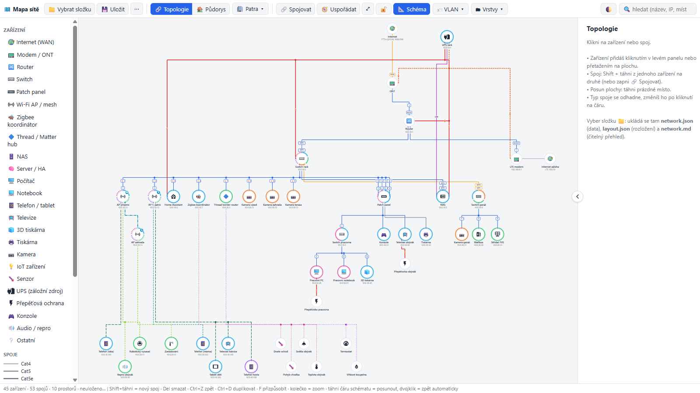
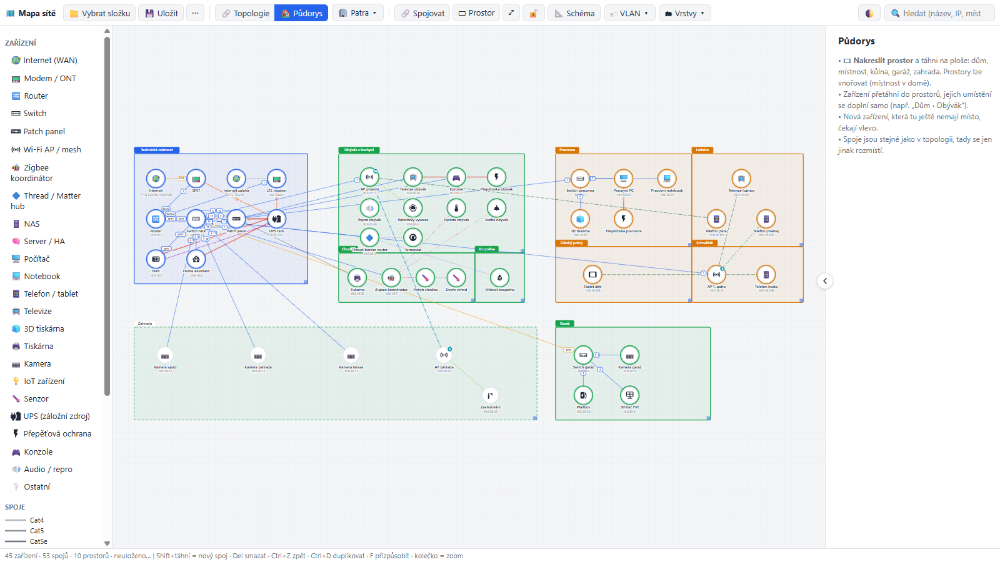

# Home Network Map · Mapa domácí sítě

[English](#english) · [Česky](#česky)



---

## English

A single-file editor for documenting a home network: `mapa.html` (vanilla JS + SVG, no dependencies, no build step).
It draws the network as a **topology** (a tree from the internet down to every device) and as a **floor plan** (rooms, floors, garden, outbuildings).

> The user interface is in **Czech**. The code and data format are plain and easy to follow, translations are welcome.

### Features
- **Devices and links:** routers, switches, patch panels, Wi-Fi APs and mesh, NAS, servers, cameras, IoT, Zigbee/Thread, UPS and surge protectors. Links include cable categories, fiber, Wi-Fi bands, mesh backhaul, Zigbee, Thread, power, and USB.
- **Ports:** port groups with role (WAN, uplink…), speed, and PoE; PoE budget; parallel cables (LAG/bonding); port conflict checks.
- **VLANs:** networks defined on the router, untagged/tagged ports, SSIDs, membership derived through the tree, and a VLAN filter.
- **Firewall:** a hand-maintained rule and port-forward table with sanity checks (unknown networks, IPs without a device, rules shadowed by an earlier rule). The router is never connected to the map on purpose.
- **Schematic view:** orthogonal "rake" routing, power drawn separately, and segments you can drag by hand. **Auto layout** orders children by port number.
- **Floor plan:** rooms, floors with colors and a floor filter, and room assignment by position.
- **Layers:** cable, Wi-Fi, mesh, Zigbee, Matter, and power.
- **Output:** `network.md` is a compact text tree of the whole network, handy for people and AI assistants. Interactive **HTML export** gives you one file that opens anywhere in read-only mode, with optional removal of firewall, notes, and MAC addresses.
- **Server (optional):** a small FastAPI server in Docker (e.g. Synology). It provides login with optional TOTP 2FA, several sites ("objects"), backups with diff and restore, three-way merge for edits from more computers, and an **nmap scan** compared against the map.
- Dark mode and a mobile layout.

### Quick start
1. Open `mapa.html` in Chrome or Edge (folder saving needs the File System Access API).
2. Click 📁 and pick the `ukazka/` folder to load the **demo network**: a fictional family house with 45 devices, 5 VLANs, 3 floors, a garage, and a firewall.
3. For your own network, pick an empty folder (e.g. `data/`). Without a folder, the map is saved in the browser's localStorage.

The editor saves three files: `network.json` (devices and links), `layout.json` (positions and floor plan), and `network.md` (the generated text overview).

### Server
`docker-compose.yml` with `server/` runs the editor on a NAS or any Linux box. On first start the server creates an empty site "Domov" and the demo site "Ukázka". See [`docs/nas.md`](docs/nas.md) (Czech).

```
docker compose up -d --build
docker exec -it netmap python app.py passwd
```

Then open `http://<server>:8780/`.

### License
No license has been chosen yet, so all rights are reserved.

---

## Česky

Editor mapy domácí sítě v jednom souboru `mapa.html` (vanilla JS a SVG, bez závislostí a bez sestavování).
Síť kreslí jako **topologii** (strom od internetu ke každému zařízení) a jako **půdorys** (místnosti, patra, zahrada, garáž).



### Co umí
- **Zařízení a spoje:** router, switch, patch panel, Wi-Fi AP a mesh, NAS, server, kamery, IoT, Zigbee/Thread, UPS a přepěťová ochrana. Spoje: kategorie kabelů, optika, pásma Wi-Fi, mesh páteř, Zigbee, Thread, napájení a USB.
- **Porty:** skupiny portů s rolí (WAN, uplink…), rychlostí a PoE, PoE rozpočet, souběžné kabely (bond), kontrola obsazených portů.
- **VLANy:** sítě definované na routeru, netagované a tagované porty, SSID, členství odvozené ze stromu a filtr podle VLAN.
- **Firewall:** ručně vedená tabulka pravidel a přesměrování portů s kontrolami (neznámá síť, IP bez zařízení, pravidlo zakryté dřívějším). Router se s mapou záměrně nepropojuje.
- **Schéma:** pravoúhlé vedení čar („hrábě“), napájení zvlášť, úseky jde posouvat ručně. **Uspořádání** řadí zařízení podle čísel portů.
- **Půdorys:** prostory, patra s barvami a filtrem, místnost se zařízení doplní podle polohy.
- **Vrstvy:** kabel, Wi-Fi, mesh, Zigbee, Matter a napájení.
- **Výstup:** `network.md` je stručný textový strom celé sítě, čitelný pro lidi i pro AI asistenty. **Export HTML** vytvoří jeden soubor, který se otevře kdekoli jen na prohlížení, a firewall, poznámky a MAC adresy jde z exportu vynechat.
- **Server (volitelný):** malý FastAPI server v Dockeru (např. Synology). Umí přihlášení s volitelným 2FA (TOTP), víc objektů (dům, chata…), zálohy s porovnáním a obnovou a třícestné slučování úprav z víc počítačů. Umí i **sken sítě přes nmap** s porovnáním proti mapě.
- Tmavý režim a rozložení pro mobil.

### Jak začít
1. Otevři `mapa.html` v Chrome nebo Edge (ukládání do složky potřebuje File System Access API).
2. Přes 📁 vyber složku `ukazka/` a načte se **ukázková síť**: fiktivní rodinný dům se 45 zařízeními, 5 VLANami, 3 podlažími, garáží a firewallem.
3. Pro vlastní síť vyber prázdnou složku (např. `data/`, je v `.gitignore`). Bez složky se mapa ukládá do localStorage prohlížeče.

Editor ukládá tři soubory: `network.json` (zařízení a spoje), `layout.json` (pozice a půdorys) a `network.md` (vygenerovaný textový přehled).

### Server
`docker-compose.yml` se složkou `server/` spustí editor na NAS nebo libovolném Linuxu. Při prvním startu server založí prázdný objekt „Domov“ a objekt „Ukázka“ s ukázkovou sítí. Podrobnosti jsou v [`docs/nas.md`](docs/nas.md).

```
docker compose up -d --build
docker exec -it netmap python app.py passwd
```

Pak otevři `http://<server>:8780/`.

### Licence
Licence zatím není vybraná, všechna práva jsou vyhrazena.
